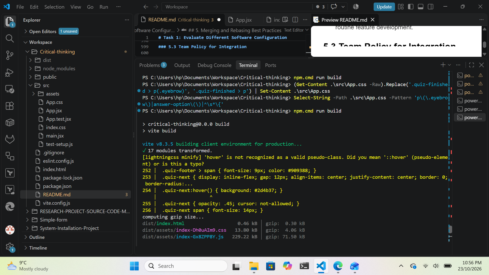
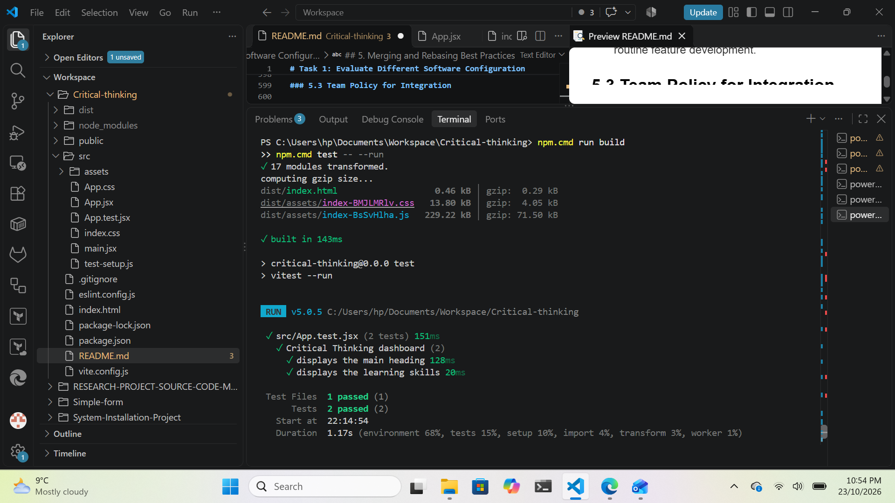
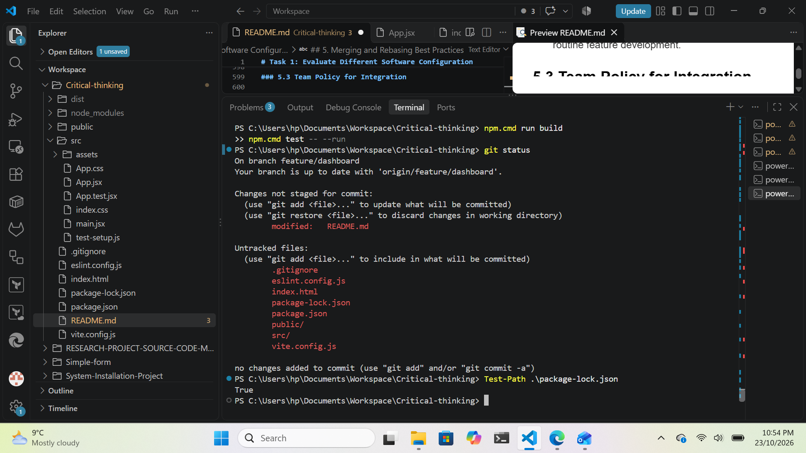
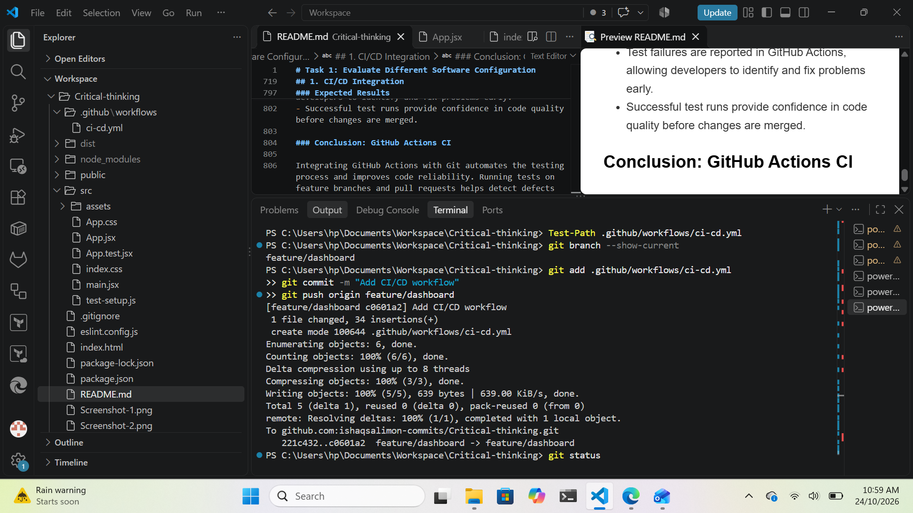
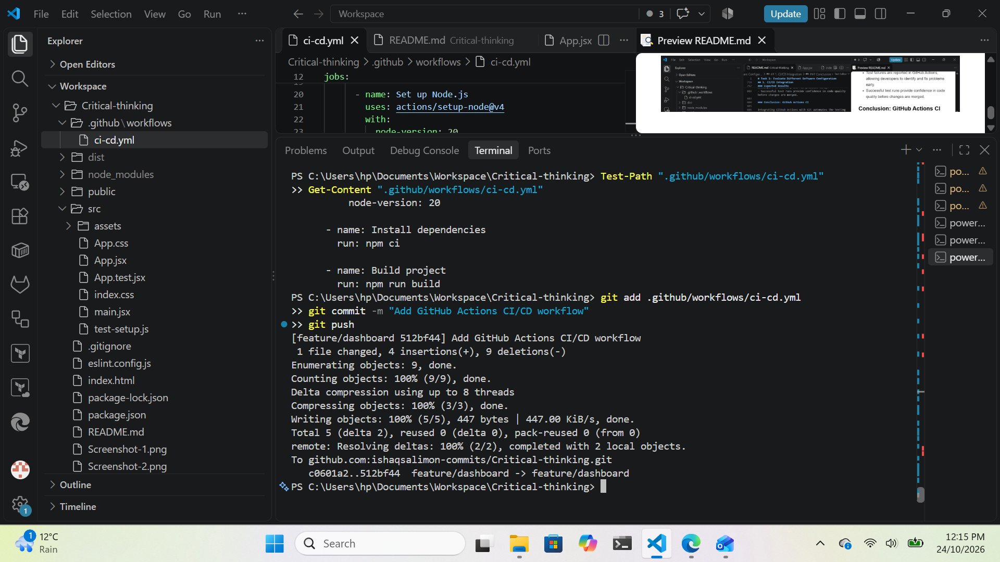
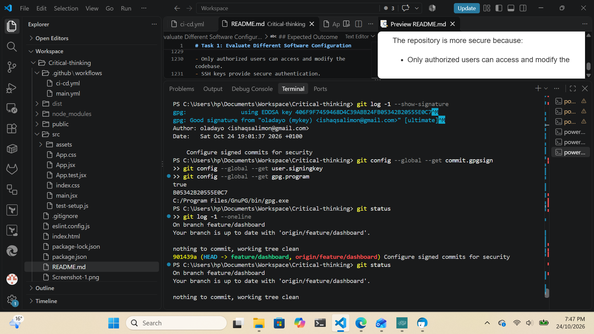
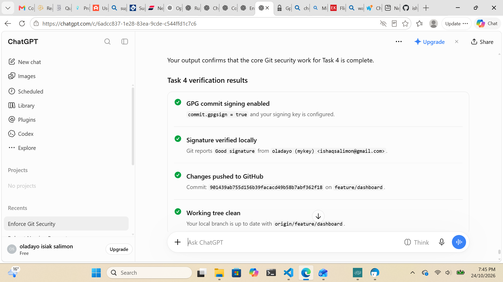

# Task 1: Evaluate Different Software Configuration Management (SCM) Tools

1. Introduction

Software Configuration Management (SCM) is the process of tracking, controlling, and managing changes to source code, configuration files, documentation, and other software artifacts throughout the software development lifecycle.

As the company transitions from a centralized development process to a distributed team, selecting an appropriate version control system (VCS) is essential. Developers working across multiple geographic locations need a system that supports collaboration, efficient branching, secure code management, and integration with Continuous Integration and Continuous Delivery (CI/CD) pipelines.

This task evaluates centralized and distributed version control systems, focusing on Subversion (SVN), Git, and Mercurial, to determine the most suitable solution for the organization.

## 2. Centralized vs. Distributed Version Control Systems

2.1 Centralized Version Control System (CVCS)

A centralized version control system stores the primary repository on a central server. Developers connect to this server to check out files, commit changes, and retrieve updates.

Example: Subversion (SVN)

Key characteristics:

A central repository acts as the primary source of truth.

Developers generally need network access to commit changes to the shared repository.

Access controls can be managed centrally.

Branching and merging are supported, although workflows differ from Git's.

Repository administration and backup can be managed centrally.

Advantages:

Simple, centralized administration.

Straightforward permission management.

A clear, authoritative repository for teams.

Suitable for workflows requiring centralized control over commits.

Challenges:

Network connectivity is generally required to commit changes to the central repository.

Server outages can interrupt shared development activities.

Distributed teams may experience latency when accessing a remote server.

Branching and merging can be less convenient for frequent, parallel development.

Developers have less repository-level autonomy when working offline.

2.2 Distributed Version Control System (DVCS)

A distributed version control system gives each developer a local repository containing the project's version history. Developers can commit changes locally and synchronize them with remote repositories when needed.

Examples: Git and Mercurial

Key characteristics:

Each clone contains the repository's commit history.

Developers can commit, branch, inspect history, and compare changes offline.

Changes are shared through operations such as pushing and pulling.

Branching and merging support parallel development.

Multiple remotes can be configured for different collaboration or deployment workflows.

Advantages:

Supports developers working across different time zones and locations.

Enables offline development and local commits.

Provides fast local operations, including branching and history inspection.

Supports flexible collaboration through feature branches and code reviews.

Integrates well with modern automation and CI/CD systems.

Challenges:

Teams need consistent policies for branching, merging, and releases.

Repository synchronization can introduce merge conflicts.

Repository permissions and secrets require careful management.

Large repositories and binary files may require additional optimization.

Developers need training in distributed workflows and conflict resolution.

## 3. Comparison of SVN, Git, and Mercurial

SVN (Subversion), Git, and Mercurial are version control systems (VCS) used to track changes to files, manage source code, collaborate with teams, and maintain project history. Their main difference is how they store history and support collaboration.

SVN — Centralized version control
A central server stores the repository history. Developers check out working copies and normally contact the server to commit changes.

Git — Distributed version control
Every clone contains the repository history. Developers can commit, create branches, compare changes, and inspect history locally, then synchronize with a remote repository.

Mercurial — Distributed version control
Like Git, each clone has its own repository history. It supports local commits, branching, merging, and synchronization with remote repositories.

## 4. Advantages of Git in a Distributed Environment

4.1 Offline Development

Git allows developers to commit changes, inspect history, create branches, and compare revisions without continuous access to a remote server. This is particularly valuable for team members working in different regions or with unreliable network connections.

4.2 Efficient Branching and Merging

Git makes it practical to create short-lived feature branches for individual tasks. Developers can implement features, fix bugs, and experiment independently without immediately affecting the main branch.

For example:

main: Contains production-ready code.

feature/user-authentication: Implements a new authentication feature.

bugfix/payment-validation: Fixes a payment validation issue.

release/2.0: Prepares a release, if the team uses release branches.

Branches can be merged through reviewed pull requests after the required checks pass.

4.3 Improved Collaboration

Git supports several collaboration patterns, including shared repositories, forks, and multiple remotes. These options allow developers to work independently while sharing changes through controlled integration points.

Pull requests or merge requests provide a structured way to review code, discuss implementation decisions, and verify automated test results before merging.

4.4 Performance and History Management

Most Git operations are performed locally, which reduces dependence on network latency. Git also records changes as commits, allowing developers to investigate regressions, compare versions, and revert problematic changes.

4.5 Integration with DevOps and CI/CD

Git integrates with platforms and tools such as GitHub, GitLab, Bitbucket, Jenkins, and other CI/CD systems.

Automation can be triggered by commits, pushes, or pull requests to perform:

Automated unit and integration testing.

Code formatting and linting.

Static application security testing (SAST).

Dependency and vulnerability scanning.

Build and deployment processes.

Release tagging and artifact generation.

These integrations help enforce consistent quality standards across a geographically distributed team.

4.6 Resilience and Repository Availability

Each full Git clone contains substantial repository history. This provides useful redundancy if a developer's working copy is lost or a remote server becomes temporarily unavailable.

However, a clone is not a complete replacement for a managed backup strategy. The organization should maintain protected, independently recoverable backups of its authoritative repositories.

## 5. Challenges of Adopting Git

5.1 Learning Curve

Git's distributed model introduces concepts such as staging, commits, rebasing, merging, remotes, and detached HEAD states. Developers familiar with SVN may need training to use these features safely.

Mitigation: Provide onboarding documentation, practical exercises, standard command examples, and guidance on resolving conflicts.

5.2 Merge Conflicts

When developers modify overlapping sections of the same files, Git may be unable to merge the changes automatically.

Mitigation:

Keep feature branches short-lived.

Synchronize frequently with the target branch.

Encourage small, focused commits.

Require automated tests after conflict resolution.

Use code reviews to validate the final changes.

5.3 Poor Branch Management

Long-lived feature branches can diverge significantly from the main branch, increasing integration risk and delaying feedback.

Mitigation: Adopt a documented branching strategy, such as trunk-based development with short-lived feature branches. Protect the main branch and require pull requests for changes.

5.4 Repository Growth

Large binary assets, generated files, and extensive histories can increase clone times and repository storage requirements.

Mitigation:

Add appropriate entries to .gitignore.

Avoid committing build artifacts and secrets.

Use Git Large File Storage (Git LFS) when suitable for large binary assets.

Consider shallow clones, partial clones, or repository restructuring where appropriate.

5.5 Security and Access Control

Distributed copies increase the number of locations where source code and history may exist. A local repository may contain sensitive historical information even if the current files do not.

Mitigation:

Apply least-privilege repository access.

Enforce multifactor authentication for hosting accounts.

Store credentials in approved credential managers.

Never commit API keys, passwords, private keys, or other secrets.

Scan for exposed secrets and revoke compromised credentials.

Protect important branches and require reviews for sensitive changes.

Audit repository access and administrative activity.

5.6 Inconsistent Development Practices

Without common standards, different developers may use inconsistent commit messages, branch names, testing procedures, or merge strategies.

Mitigation: Establish shared conventions, automated checks, code review requirements, and documented release procedures.

1. Git vs. Mercurial

Git and Mercurial are both mature distributed version control systems. Both support offline commits, repository cloning, branching, merging, and collaborative development.

Git is the stronger candidate for this organization primarily because of its broad industry adoption, extensive integration ecosystem, and compatibility with commonly used code-hosting and DevOps platforms.

Mercurial remains a technically capable alternative and may be appropriate for teams already using it successfully. However, the organization should compare hosting options, automation requirements, team familiarity, and long-term maintenance costs before making a final selection.

The choice should be based on operational needs rather than assuming that one DVCS is universally superior.

### Recommended SCM Solution

Recommendation: Adopt Git with a centrally hosted, access-controlled remote repository.

Although Git is distributed, the organization should maintain a designated authoritative remote repository to provide a consistent source of truth for collaboration, reviews, and releases.

The proposed approach includes:

Repository hosting: Select a managed Git platform, such as GitHub, GitLab, or Bitbucket, based on security, integration, cost, and compliance requirements.

Branching strategy: Use short-lived feature branches and a protected main branch. Adopt trunk-based development where practical.

Code review: Require pull requests or merge requests for changes to protected branches.

Quality assurance: Run automated tests, linting, and security checks before merging.

Access management: Apply least privilege, multifactor authentication, and appropriate audit controls.

CI/CD integration: Automate builds, tests, and deployments through approved pipelines.

Backup and recovery: Maintain protected backups and periodically test repository restoration.

Developer training: Provide documentation and practical training for Git workflows and conflict resolution.

#### Conclusion

Git is the recommended version control system for the company's transition to distributed software development. Compared with a centralized system such as SVN, Git provides offline development, fast local operations, flexible branching, and strong integration with modern DevOps practices.

Mercurial also offers distributed development capabilities, but Git's wider ecosystem makes it a practical choice for a team seeking scalable collaboration and automation.

Successful adoption will depend not only on selecting Git but also on establishing secure repository hosting, consistent branching policies, mandatory code reviews, automated quality checks, developer training, and reliable backup procedures. These practices will help the organization build a secure, maintainable, and scalable SCM process for its distributed workforce.

Git Workflow for Feature Branching and a Stable Main Branch
For a new web application, a feature-branching workflow allows developers to work on multiple features independently while keeping the main branch stable and production-ready.

1. Branching strategy

Use the following branch structure:
main

Stable, production-ready code

Create feature branches

feature/login

Developer A works on authentication.

feature/dashboard

Developer B works on the dashboard.

Pull requests, code reviews and automated tests

Merge into main

Only after required checks pass

1. Implement the Git workflow
Step 1: Create the repository
git init
git add .
git commit -m "chore: initial project setup"

git branch -M main
git remote add origin YOUR_REPOSITORY_URL
git push -u origin main

Replace `<repository-url>` with the URL of your remote repository, such as a GitHub repository.
Step 2: Create a feature branch
Each developer creates a separate branch from the latest main branch.
git switch main
git pull origin main

git switch -c feature/login

Another developer can work independently:
git switch main
git pull origin main

git switch -c feature/dashboard

Use descriptive branch names such as feature/user-profile, fix/login-error, or feature/payment-integration.
Step 3: Develop and commit changes
Developers commit their changes to their own branches rather than directly to main.
git add .
git commit -m "feat: implement login functionality"
git push -u origin feature/login

For the dashboard developer:
git add .
git commit -m "feat: implement dashboard layout"
git push -u origin feature/dashboard

Make small, focused commits with meaningful messages.
Step 4: Open a pull request
Once the feature is complete:

1. Open a pull request from the feature branch into main.
2. Request a review from another developer.
3. Run automated tests, linting and build checks.
4. Address review comments and push any required changes.
5. Merge the pull request only when all required checks pass.
Step 5: Protect the main branch
Configure branch protection rules in GitHub, GitLab or your chosen Git hosting service.

Recommended settings:

- Require pull requests before merging.
- Require at least one approving code review.
- Require automated CI checks to pass.
- Require the branch to be up to date with the target branch, if appropriate.
- Block force pushes and deletion of main.
- Restrict direct pushes to main.

These rules help prevent incomplete or broken code from entering the stable branch.

Step 6: Update the feature branch
If another developer merges changes into main while your feature is in progress, incorporate those changes regularly.
git switch feature/login
git fetch origin
git merge origin/main

Resolve any merge conflicts, run the tests again, and push the updated branch.
Step 7: Clean up after merging
After the pull request is merged, update your local repository and delete the completed feature branch.
git switch main
git pull origin main

git branch -d feature/login
git fetch --prune

The remote feature branch can also be deleted through the hosting platform or, if necessary, using:
git push origin --delete feature/login

1. Automate testing with CI
Automate testing with CI
Configure a continuous integration (CI) pipeline to run on every pull request. For example, a GitHub Actions workflow for a Node.js web application might look like this:

name: CI

on:
  pull_request:
    branches:
      - main
  push:
    branches:
      - main

jobs:
  test:
    runs-on: ubuntu-latest

    steps:
      - name: Checkout code
        uses: actions/checkout@v4

      - name: Set up Node.js
        uses: actions/setup-node@v4
        with:
          node-version: 22
          cache: npm

      - name: Install dependencies
        run: npm ci

      - name: Run tests
        run: npm test -- --run

      - name: Build application
        run: npm run build

This example assumes the project has a package-lock.json, a test script compatible with npm test -- --run, and a build script. Adjust the commands to match the project's framework and test runner. The required CI check must be configured in the repository's branch protection settings.





## Team Git Workflow Guide

**Project:** Web Application Development  
**Version:** 1.0

## 1. Purpose

This guide establishes a consistent Git workflow that enables developers to work on multiple features simultaneously while maintaining a stable, reliable `main` branch.

The workflow supports parallel development, code reviews, automated testing, conflict resolution, and effective collaboration among team members working from different locations and time zones.

## 2. Branching Strategy

The team will use a **feature-branch workflow** with `main` as the primary integration branch.

### 2.1 Main Branch

- `main` must always contain stable, reviewed, and tested code.
- Direct pushes to `main` are prohibited.
- All changes must be submitted through pull requests.
- Required automated checks and code reviews must pass before merging.
- Releases should be created from verified commits on `main`, using tags where appropriate.

### 2.2 Feature Branches

Each feature, bug fix, or maintenance task should have its own branch created from the latest `main`.

Branch names should be descriptive, concise, and related to a task or issue identifier when applicable.

### 2.3 Creating a Feature Branch

Developers should begin by updating their local `main` branch:

git switch main
git pull --ff-only origin main
git switch -c feature/user-login

Work should be committed to the feature branch rather than directly to `main`.

git add .
git commit -m "feat: implement user login"
git push -u origin feature/user-login

Developers should push their branches regularly so that their work is backed up and accessible to teammates.

## 3. Daily Development Workflow

The team will follow this sequence:

1. Select a task from the project board.
2. Create a feature branch from the latest `main`.
3. Implement the feature and commit changes incrementally.
4. Run relevant tests and checks locally.
5. Push the branch to the shared repository.
6. Open a pull request when the changes are ready for review.
7. Address review feedback and resolve conflicts.
8. Merge after approval and successful CI checks.
9. Delete the completed branch and update the local repository.

Developers should keep branches focused on one task wherever possible. Large features should be divided into smaller, reviewable changes.

## 4. Pull Request Procedure

Pull requests (PRs) are the standard method for proposing and reviewing changes before they enter `main`.

### 4.1 Opening a Pull Request

Each pull request should include:

- A clear title describing the change.
- A summary of what was implemented and why.
- A reference to the relevant issue or task.
- Testing performed and the results.
- Screenshots or recordings for significant user-interface changes, where useful.
- Any risks, migration requirements, or configuration changes.

The PR description should help reviewers understand the change without requiring extensive additional explanation.

### 4.2 Code Review Requirements

Reviewers should verify that:

- The implementation meets the task requirements.
- Code is readable, maintainable, and consistent with team conventions.
- Tests cover the important new behaviour.
- Existing functionality has not been unintentionally broken.
- Security, performance, accessibility, and error handling have been considered where relevant.
- Documentation and configuration are updated when necessary.

At least one approval from another developer is required before merging. Higher-risk changes may require additional reviewers.

Authors should respond constructively to feedback, explain design decisions when necessary, and push revisions to the same branch. Reviewers should focus on the code and its impact rather than personal preferences.

### 4.3 Automated Checks

Every pull request targeting `main` must pass the project's required continuous integration (CI) checks, including applicable:

- Unit and integration tests.
- Linting and formatting checks.
- Type checking.
- Production builds.
- Security or dependency checks, where configured.

The pull request must not be merged if a required check fails. Failures should be investigated and corrected before approval or merging.

### 4.4 Merging a Pull Request

Once the required reviews and checks have passed:

1. Confirm that the pull request is ready to merge.
2. Resolve outstanding review comments and conversations.
3. Ensure the branch is sufficiently up to date with `main`.
4. Use the team's agreed merge method.
5. Delete the feature branch after merging, unless it is intentionally retained.

## 5. Merging and Rebasing Best Practices

Merging and rebasing both integrate changes, but they have different effects on Git history.

### 5.1 Merge

A merge combines the histories of two branches and may create a merge commit.

git switch feature/user-login
git fetch origin
git merge origin/main

If conflicts occur, resolve them in the affected files, test the result, and complete the merge.

**Use merging when:**

- Integrating changes from `main` into a shared feature branch.
- Preserving the history of parallel development is important.
- Multiple developers are collaborating on the same branch.

Advantages:

- Preserves existing commit history.
- Does not rewrite existing commits.
- Makes branch integration points explicit.

### 5.2 Rebase

Rebasing replays commits on top of another base commit, producing a more linear history.

git switch feature/user-login
git fetch origin
git rebase origin/main

If conflicts occur, resolve each affected file and continue:

git add `<resolved-file>`
git rebase --continue

To abandon the rebase and return to the original branch state:

git rebase --abort

After rebasing a branch that has already been pushed, its commit history may differ from the remote branch. If the branch is exclusively owned by the developer and the team permits rewriting it, update the remote using:

git push --force-with-lease

Never use `git push --force` indiscriminately. Do not rebase shared branches that other developers rely on without explicit coordination.

**Use rebasing when:**

- Updating a private feature branch with the latest `main`.
- Cleaning up local commits before sharing them, when appropriate.
- Preparing a focused, easy-to-review commit history.

Advantages:

- Produces a more linear history.
- Can make the sequence of changes easier to follow.
- Avoids unnecessary merge commits during routine feature development.

### 5.3 Team Policy for Integration

The team will adopt the following defaults:

- **Feature branch maintenance:** Rebase private feature branches onto the latest `main` when a linear history is desirable.
- **Shared feature branches:** Prefer merging `main` into the branch to avoid rewriting commits that teammates may already have fetched.
- **Pull request integration:** Use squash merging for independent feature branches to keep `main` concise, unless preserving individual commits or explicit merge history is important.
- **Main branch:** Never rebase or force-push `main`.
- **Conflict resolution:** Resolve conflicts deliberately, inspect the final diff, and rerun relevant tests.

The repository should configure one preferred merge method so the team follows a predictable convention.

## 6. Handling Merge Conflicts

Merge conflicts occur when Git cannot automatically reconcile competing changes.

The developer integrating the changes is responsible for resolving conflicts correctly.

Recommended procedure:

1. Fetch the latest remote changes.
2. Merge or rebase the target branch into the feature branch.
3. Inspect each conflicted file.
4. Discuss ambiguous changes with the affected teammate.
5. Remove conflict markers and preserve the intended behaviour of both changes.
6. Run tests, linting, and builds as appropriate.
7. Commit the resolution if merging, or continue the rebase if rebasing.
8. Push the updated branch and rerun the required CI checks.

Developers must not resolve conflicts by blindly accepting one side's changes. When the correct result is unclear, they should consult the original authors.

## 7. Collaboration in a Distributed Team

This workflow supports distributed collaboration by making work visible, traceable, and independently reviewable.

### 7.1 Asynchronous Communication

Developers should use pull requests, issue trackers, and team communication channels to document progress and decisions. Work should not depend on everyone being online simultaneously.

PR descriptions and review comments should provide enough context for colleagues in other time zones to continue the work without waiting for a meeting.

### 7.2 Shared Ownership and Visibility

Pushing feature branches to a shared remote repository gives teammates access to ongoing work. Draft pull requests allow early feedback before a feature is complete.

Branch names, commits, issue references, and PR descriptions create a traceable record of why changes were made and who reviewed them.

### 7.3 Reducing Integration Conflicts

Developers should:

- Keep branches short-lived.
- Integrate changes from `main` regularly.
- Divide large tasks into smaller, independent features.
- Communicate when multiple people must modify the same files or modules.
- Coordinate API, database, and shared-component changes before implementation.
- Avoid leaving completed work unreviewed for long periods.

### 7.4 Review Responsibilities

Reviewers should acknowledge requests promptly and communicate expected review timelines. Authors should identify blocking questions clearly and avoid treating review feedback as personal criticism.

For handovers between time zones, developers should document what has changed, what remains unfinished, any known issues, and the next required action.

### 7.5 Access and Security

All developers should use individual repository accounts with appropriate permissions. Credentials, access tokens, passwords, and other secrets must never be committed to Git.

Protected branches and required CI checks should be enforced centrally rather than relying on every developer to remember the rules.

## 8. Emergency Fixes

For urgent production issues:

1. Create a `hotfix/description` branch from the relevant production baseline, normally `main`.
2. Implement the smallest safe correction.
3. Add or update regression tests.
4. Obtain expedited peer review and run required checks.
5. Merge the approved fix into `main`.
6. Deploy according to the team's release process.
7. Verify the fix in production and communicate the outcome.
8. If the fix was made against a different release branch, ensure it is also incorporated into `main` and any other affected maintained branches.

Emergency procedures should accelerate review, not eliminate essential safety checks.

## 9. Git Commands Reference

| Update local main | `git switch main && git pull --ff-only origin main` |
| Create feature branch | `git switch -c feature/my-feature` |
| Stage changes | `git add .` |
| Commit changes | `git commit -m "feat: describe change"` |
| Push branch | `git push -u origin feature/my-feature` |
| Fetch remote changes | `git fetch origin` |
| Merge main into feature | `git merge origin/main` |
| Rebase feature onto main | `git rebase origin/main` |
| Inspect status | `git status` |
| Inspect changes | `git diff` |
| List branches | `git branch -a` |
| Delete merged local branch | `git branch -d feature/my-feature` |

## 10. Summary and Team Commitments

All team members are expected to follow these principles:

1. Develop features on separate branches.
2. Keep `main` stable and protected.
3. Submit changes through pull requests.
4. Require code review and successful automated checks.
5. Choose merge or rebase based on the branch's ownership and the team's agreed policy.
6. Resolve conflicts carefully and test the result.
7. Communicate progress and decisions clearly across time zones.
8. Keep branches focused, short-lived, and regularly integrated.
9. Never commit secrets or force-push to `main`.
10. Maintain an auditable record of changes, reviews, and releases.

**Expected outcome:** The team can develop multiple features in parallel, integrate changes predictably, reduce avoidable conflicts, and maintain a stable main branch. A shared, documented process also allows distributed developers to collaborate asynchronously while preserving code quality, accountability, and delivery consistency.

## Task 3: Automate Code Quality and Deployment

## 1. CI/CD Integration

### Objective

To ensure code quality and support rapid development, a Continuous Integration/Continuous Deployment (CI/CD) pipeline will be integrated with Git. Automated tests will run whenever a new feature branch is pushed to the remote repository.

### Tools Used

- **Git:** Version control and branch management.
- **GitHub:** Remote repository hosting.
- **GitHub Actions:** Automates testing and CI/CD workflows.
- **Automated Testing Framework:** Runs the project's test suite.

### Implementation Steps

#### Step 1: Create a Feature Branch

Create a new branch for the feature you want to develop.

git checkout -b feature/new-feature

#### Step 2: Configure GitHub Actions

Create a workflow file in the repository at `.github/workflows/ci.yml`.

    name: CI - Automated Tests

    on:
      push:
        branches:
          - 'feature/**'
      pull_request:
        branches:
          - main

    jobs:
      test:
        runs-on: ubuntu-latest

        steps:
          - name: Checkout repository
            uses: actions/checkout@v4

          - name: Set up Python
            uses: actions/setup-python@v5
            with:
              python-version: '3.x'

          - name: Install dependencies
            run: |
              python -m pip install --upgrade pip
              if [ -f requirements.txt ]; then
                pip install -r requirements.txt
              fi
              pip install pytest

          - name: Run automated tests
            run: pytest

**Note:** This example assumes the project uses Python and `pytest`. Replace the setup and test commands if the project uses another language or testing framework.

#### Step 3: Commit and Push Changes

Save the workflow file and push the feature branch to GitHub.

git add .github/workflows/ci.yml
git commit -m "Add automated CI testing workflow"
git push -u origin feature/new-feature

#### Step 4: Verify the Pipeline

1. Open the repository on GitHub.
2. Navigate to the **Actions** tab.
3. Select the **CI - Automated Tests** workflow.
4. Confirm that the workflow starts after the feature branch is pushed.
5. Check the job logs to verify that dependencies are installed and tests execute successfully.
6. Introduce a failing test in a temporary commit to confirm that the pipeline reports a failure.

### Expected Results

- Automated tests run whenever a feature branch matching `feature/**` is pushed.
- Pull requests targeting `main` trigger the same test suite.
- Test failures are reported in GitHub Actions, allowing developers to identify and fix problems early.
- Successful test runs provide confidence in code quality before changes are merged.

### Conclusion: GitHub Actions CI

Integrating GitHub Actions with Git automates the testing process and improves code reliability. Running tests on feature branches and pull requests helps detect defects early, supports faster development, and establishes a foundation for future automated deployment.



## GitHub Actions CI/CD Pipeline for Node.js on AWS

1. Overview
This pipeline automates testing, code quality checks, and deployment of a Node.js application to an AWS staging environment using GitHub Actions.

Pipeline workflow:

1. Developer pushes code or opens a pull request.
2. GitHub Actions installs dependencies.
3. Unit tests run automatically.
4. ESLint, Prettier, and dependency vulnerability checks execute.
5. If all checks pass on main, the application is built and deployed to AWS.
6. A health check verifies the staging deployment.
The example below uses Amazon ECS with Fargate and Amazon ECR.

Create the GitHub Actions workflow
Create the file .github/workflows/staging.yml in your repository.
name: Node.js CI/CD Pipeline

on:
  pull_request:
    branches: [main]
  push:
    branches: [main]

permissions:
  contents: read

concurrency:
  group: staging-${{ github.ref }}
  cancel-in-progress: true

jobs:
  quality:
    name: Test and Quality Checks
    runs-on: ubuntu-latest

    steps:
      - name: Checkout code
        uses: actions/checkout@v4

      - name: Set up Node.js
        uses: actions/setup-node@v4
        with:
          node-version: 22
          cache: npm

      - name: Install dependencies
        run: npm ci

      - name: Run unit tests
        run: npm test

      - name: Check code quality
        run: npm run lint

      - name: Check formatting
        run: npm run format:check

      - name: Audit dependencies
        run: npm audit --audit-level=high

  deploy-staging:
    name: Deploy to AWS Staging
    needs: quality
    if: github.event_name == 'push' && github.ref == 'refs/heads/main'
    runs-on: ubuntu-latest

    environment:
      name: staging
      url: ${{ vars.STAGING_URL }}

    permissions:
      contents: read
      id-token: write

    steps:
      - name: Checkout code
        uses: actions/checkout@v4

      - name: Configure AWS credentials
        uses: aws-actions/configure-aws-credentials@v6
        with:
          role-to-assume: ${{ vars.AWS_ROLE_ARN }}
          aws-region: ${{ vars.AWS_REGION }}

      - name: Log in to Amazon ECR
        id: ecr
        uses: aws-actions/amazon-ecr-login@v2

      - name: Build and push Docker image
        id: image
        env:
          REGISTRY: ${{ steps.ecr.outputs.registry }}
          REPOSITORY: ${{ vars.ECR_REPOSITORY }}
          IMAGE_TAG: ${{ github.sha }}
        run: |
          set -euo pipefail
          IMAGE_URI="$REGISTRY/$REPOSITORY:$IMAGE_TAG"
          docker build --pull -t "$IMAGE_URI" .
          docker push "$IMAGE_URI"
          echo "uri=$IMAGE_URI" >> "$GITHUB_OUTPUT"

      - name: Render ECS task definition
        id: task-def
        uses: aws-actions/amazon-ecs-render-task-definition@v1
        with:
          task-definition: ecs-task-definition.json
          container-name: ${{ vars.CONTAINER_NAME }}
          image: ${{ steps.image.outputs.uri }}

      - name: Deploy to ECS
        uses: aws-actions/amazon-ecs-deploy-task-definition@v2
        with:
          task-definition: ${{ steps.task-def.outputs.task-definition }}
          service: ${{ vars.ECS_SERVICE }}
          cluster: ${{ vars.ECS_CLUSTER }}
          wait-for-service-stability: true

      - name: Verify staging health
        env:
          STAGING_URL: ${{ vars.STAGING_URL }}
        run: |
          set -euo pipefail
          test -n "$STAGING_URL"
          curl --fail --silent --show-error \
            --retry 12 \
            --retry-delay 5 \
            --retry-connrefused \
            --max-time 10 \
            "$STAGING_URL/health"

Note: The workflow assumes that the repository contains a Dockerfile, an ECS task definition, and a /health endpoint. Replace the example action version tags with verified full commit SHAs for hardened production use.

1. Configure Node.js scripts
Ensure your package.json includes the scripts required by the pipeline.
{
  "scripts": {
    "test": "jest --ci",
    "lint": "eslint .",
    "format:check": "prettier --check ."
  }
}

Install the development dependencies if necessary:
npm install --save-dev jest eslint prettier

Commit both package.json and package-lock.json. If the project uses Vitest or another test framework, adjust the test command accordingly.

Configure GitHub Actions variables
Navigate to GitHub → Settings → Secrets and variables → Actions → Variables and configure the following variables.

Create a GitHub environment named staging under Settings → Environments. Restrict it to the main branch and configure reviewers if deployment approval is required.

Secure AWS authentication with OIDC
Use GitHub's OpenID Connect integration to authenticate to AWS without storing long-lived access keys.

1. Create the GitHub OIDC identity provider in AWS IAM.
2. Create a dedicated IAM role for staging deployments.
3. Restrict the role's trust policy to the specific repository and staging environment.
4. Grant only the permissions required to publish images to the designated ECR repository and update the intended ECS service.
5. Set AWS_ROLE_ARN in GitHub Actions variables.
Example trust policy:
{
  "Version": "2012-10-17",
  "Statement": [
    {
      "Effect": "Allow",
      "Principal": {
        "Federated": "arn:aws:iam::AWS_ACCOUNT_ID:oidc-provider/token.actions.githubusercontent.com"
      },
      "Action": "sts:AssumeRoleWithWebIdentity",
      "Condition": {
        "StringEquals": {
          "token.actions.githubusercontent.com:aud": "sts.amazonaws.com",
          "token.actions.githubusercontent.com:sub": "repo:YOUR_ORG/YOUR_REPO:environment:staging"
        }
      }
    }
  ]
}

Replace AWS_ACCOUNT_ID, YOUR_ORG, and YOUR_REPO with the correct values. Configure the role's permissions policy separately, including appropriately restricted iam:PassRole permissions for the ECS task and execution roles.
6. Verification checklist

- [ ] Unit tests run successfully on every pull request.
- [ ] ESLint and Prettier checks pass.
- [ ] Dependency vulnerability checks pass.
- [ ] Branch protection requires successful quality checks before merging.
- [ ] AWS authentication works through OIDC.
- [ ] Docker images are pushed to ECR using the Git commit SHA as the tag.
- [ ] ECS deploys the updated task definition and reaches a stable state.
- [ ] The staging health endpoint returns HTTP 2xx.
- [ ] Failed checks prevent deployment.
- [ ] A rollback procedure is documented and tested.

Expected result
Once configured, every pull request targeting main will trigger automated testing and code quality checks. After a successful merge, GitHub Actions will build the container image, publish it to Amazon ECR, deploy it to the ECS staging service, and verify application health.



## CI/CD Pipeline Guide

### Overview

The CI/CD pipeline automates code validation and provides a controlled route to production using GitHub Actions.

The pipeline runs tests and builds the application before allowing a production deployment. A failed test or build prevents the deployment job from proceeding.

## How the pipeline works

1. **Pull request:** The pipeline installs dependencies, runs lint checks, executes tests, and builds the application.
2. **Merge to main:** The pipeline runs the same validation against the updated main branch.
3. **Manual production release:** An authorised developer starts the workflow from the main branch. The production deployment job runs only after validation succeeds.
4. **Deployment protection:** GitHub environment rules can require approval before production deployment begins.
5. **Verification:** Confirm the deployment completed successfully and the application health checks pass.

## How to run tests

### Automatically

Create a feature branch, make a change, and open a pull request targeting `main`. GitHub Actions starts the workflow automatically.

### Manually

1. Open the repository on GitHub.
2. Select **Actions**.
3. Select **CI/CD Pipeline**.
4. Click **Run workflow**.
5. Select the `main` branch and start the workflow.

Inspect the job logs to identify failed tests, lint errors, or build problems.

### Locally

Run the following commands from the project root:

npm ci
npm test
npm run build

If linting is configured, also run:

npm run lint

## How to deploy new code

1. Create a feature branch.
2. Implement the change and add or update tests.
3. Commit and push your changes.
4. Open a pull request and resolve all failing checks.
5. Merge into `main` after review and required checks pass.
6. Open Actions and manually run the CI/CD Pipeline using `main`.
7. Approve the production deployment if the environment requires approval.
8. Confirm the deployment succeeded and verify the application is healthy.

The deployment command must be configured for the project's actual hosting provider before this process can deploy application code.

## Troubleshooting

- **Dependencies fail:** Check the lockfile and ensure `package.json` and the lockfile are committed.
- **Tests fail:** Reproduce the failure locally, fix the code, and push a new commit.
- **Build fails:** Check build logs, environment variables, and compiler errors.
- **Deployment does not run:** Confirm the workflow was manually started on `main` and the test job succeeded.
- **Approval is pending:** Ask an authorised environment reviewer to approve the deployment.
- **Application is unhealthy:** Follow the hosting platform's rollback procedure and investigate the deployment logs.

## Security and maintenance

- Never store credentials in source code.
- Use least-privilege repository and cloud permissions.
- Require code review and successful CI checks before merging.
- Restrict production deployments to authorised branches and users.
- Keep dependencies and GitHub Actions updated.
- Review deployment logs and periodically test rollback procedures.

## Operational ownership

The repository maintainers are responsible for maintaining workflow configuration, test coverage, deployment credentials, environment protection, and release procedures.

## Task 4: Enforce Security Best Practices in Git

## Security Objective

Secure the Git repository by implementing access controls, SSH key management, branch protection, signed commits, and sensitive data protection.

## 1. Set Up User Access Controls

- Grant users only the permissions required for their roles.
- Enable multi-factor authentication (MFA).
- Assign permissions using teams or groups.
- Remove access for users who no longer work on the project.
- Never share user accounts, passwords, or access tokens.

For GitHub:

1. Open the repository.
2. Navigate to **Settings → Collaborators** or organization access settings.
3. Add authorized team members.
4. Assign appropriate permissions.

## 2. Configure SSH Keys

### Generate an SSH key

`ssh-keygen -t ed25519 -C "your-email@example.com"`

### Start the SSH agent and add the key

eval "$(ssh-agent -s)"
ssh-add ~/.ssh/id_ed25519

### Display the public key

cat ~/.ssh/id_ed25519.pub

Add the public key to your Git hosting account under **Settings → SSH keys**. Never share your private key.

### Test SSH authentication

`ssh -T git@github.com`

### Configure the repository to use SSH

`git remote set-url origin git@github.com:ORG/REPOSITORY.git`
`git remote -v`

Replace `ORG/REPOSITORY` with your repository details.

## 3. Enable Branch Protection

Protect the `main` branch to prevent unauthorized changes.

For GitHub:

1. Open **Settings → Rules → Rulesets**.
2. Create a branch ruleset targeting `main`.
3. Enable the following rules:
   - Require pull requests before merging.
   - Require at least one approving review.
   - Dismiss stale approvals when new commits are pushed.
   - Require status checks to pass.
   - Require conversations to be resolved.
   - Block force pushes.
   - Prevent branch deletion.
   - Require signed commits where supported.

### Create a CODEOWNERS file

Create `.github/CODEOWNERS`:

text
/src/security/ @ORG/security-team
/.github/workflows/ @ORG/platform-team
/infra/ @ORG/platform-team

Replace the example team names with your actual organization teams. Configure branch protection to require code owner approval.

## 4. Enable Signed Commits

Signed commits help verify the authenticity of commits.

### Configure SSH commit signing

git config --global gpg.format ssh
git config --global user.signingkey ~/.ssh/id_ed25519.pub
git config --global commit.gpgsign true

Register the public key as a signing key in your Git hosting account.

### Create a signed commit

git add .
git commit -S -m "Apply security improvements"

### Verify the commit signature

git log -1 --show-signature

Configure the hosting platform to require signed commits on protected branches. Local Git settings alone do not enforce this requirement for other contributors.

## 5. Protect Sensitive Data

Create or update the `.gitignore` file:

  .env
  .env.*
  !.env.example
  *.pem
  *.key
  secrets/
  credentials.json

Do not commit passwords, API keys, private keys, or production credentials.

Additional measures:

- Enable secret scanning and push protection where available.
- Store credentials in a secrets manager or CI/CD secret store.
- Rotate any credentials accidentally exposed in Git history.
- Remember that removing a secret in a later commit does not remove it from earlier commits.

## 6. Verify Security Settings

Use the following checklist:

- [ ] User access permissions are configured.
- [ ] MFA is enabled where required.
- [ ] SSH keys are registered and tested.
- [ ] The `main` branch is protected.
- [ ] Pull requests require approval.
- [ ] CI checks must pass before merging.
- [ ] Signed commits are verified.
- [ ] Secret scanning is enabled where available.
- [ ] Sensitive files are excluded using `.gitignore`.

## Expected Outcome

The repository is more secure because:

- Only authorized users can access and modify the codebase.
- SSH keys provide secure authentication.
- Branch protection prevents unauthorized direct changes.
- Signed commits improve commit authenticity verification.
- Secret management reduces the risk of exposing confidential information.

**Conclusion:** These Git security best practices help protect the repository, enforce controlled collaboration, and improve the integrity of critical code changes.



## 1. Ensure Code Changes Are Auditable

Implement a mechanism for auditing code changes so that all modifications can be tracked, reviewed, and verified.

### Requirements

- **Version Control:** Use Git or an equivalent system to record all code changes, authors, timestamps, and commit messages.
- **Code Reviews:** Require peer review and approval before merging changes into protected branches.
- **Audit Logs:** Maintain secure records of code modifications, approvals, merges, and deployments.
- **Automated Verification:** Run automated tests, code quality checks, and security scans before deployment.
- **Access Control:** Restrict repository access and enforce appropriate authentication and authorisation.
- **Traceability:** Link code changes to relevant requirements, tasks, and releases.
- **Log Protection:** Prevent unauthorised modification or deletion of audit records.

### Acceptance Criteria

- Every code change is attributable to an authenticated user.
- All changes are recorded with timestamps and relevant metadata.
- Production changes require documented review and approval.
- Audit logs are protected against unauthorised tampering.
- Changes can be traced from commit through review, testing, and deployment.
- Historical changes and their associated approvals can be retrieved and verified.

**Expected Outcome:** A reliable and verifiable audit trail that ensures accountability, code integrity, and compliance.

## Deliverable: Git Repository Security Best Practices

## 1. Objective

Implement security best practices in the Git repository to prevent unauthorised access, protect code integrity, and ensure all code changes can be tracked, reviewed, and verified.

## 2. Access Controls

- Restrict repository access to authorised users.
- Apply the principle of least privilege by assigning appropriate read, write, and administrative permissions.
- Limit administrative access to trusted maintainers.
- Enable multi-factor authentication (MFA) where supported.
- Review user permissions regularly and revoke access when it is no longer required.

**Security Benefit:** Access controls reduce the risk of unauthorised modifications and help protect the codebase from compromised accounts.

## 3. Branch Protection

Configure branch protection rules for critical branches, such as `main` and `develop`.

- Require pull requests before merging changes.
- Require at least one approval from an authorised reviewer.
- Require automated tests and status checks to pass before merging.
- Restrict direct pushes and force pushes to protected branches.
- Prevent accidental deletion of protected branches.
- Require conversations and review comments to be resolved before merging, where supported.

**Security Benefit:** Branch protection ensures that code changes are reviewed and tested before integration, reducing the risk of introducing vulnerabilities or breaking existing functionality.

## 4. Commit Signing

Configure Git to sign commits using GPG or SSH signing keys.

Example configuration using SSH signing:

git config --global gpg.format ssh
git config --global user.signingkey ~/.ssh/id_ed25519.pub
git config --global commit.gpgsign true

Create a signed commit:

git commit -S -m "Implement security improvements"

Verify a commit signature:

git verify-commit HEAD

- Register the appropriate signing key with the Git hosting platform.
- Verify commit signatures before accepting changes into protected branches.
- Enable signed-commit enforcement where supported.
- Protect private signing keys and revoke compromised keys immediately.

**Security Benefit:** Commit signing helps verify the authenticity and integrity of commits, making unauthorised alterations easier to detect.

## 5. Audit and Monitoring

- Maintain records of code changes, pull requests, approvals, and deployments.
- Use Git history to track who made changes and when.
- Enable repository audit logs where available.
- Run automated tests, dependency checks, and security scans through CI/CD pipelines.
- Periodically review repository permissions and security configurations.
- Protect audit logs against unauthorised modification or deletion.

**Security Benefit:** Audit logging provides traceability and supports investigations into suspicious activity or unauthorised changes.

## 6. Verification Checklist

- [ ] Repository access is restricted to authorised users.
- [ ] Administrative privileges are limited to trusted maintainers.
- [ ] Branch protection rules are enabled for critical branches.
- [ ] Pull requests and required code reviews are enforced.
- [ ] Automated status checks must pass before merging.
- [ ] Direct pushes and force pushes are restricted.
- [ ] Commit signing is configured for contributors.
- [ ] Signed commits are verified and enforced where supported.
- [ ] Audit logs are available and protected.
- [ ] Security settings are reviewed periodically.

## 7. Expected Outcome

These controls provide multiple layers of protection for the Git repository. Access controls restrict who can modify the codebase, branch protection ensures changes are reviewed and validated, and commit signing provides a mechanism for verifying commit authenticity and integrity.

Together, these practices improve accountability, reduce the risk of unauthorised modifications, and establish a reliable audit trail for code changes.

## 8. Evidence of Implementation

Provide the following evidence to demonstrate completion:

- Screenshots or exported settings showing repository permissions.
- Evidence of enabled branch protection rules.
- Git configuration output demonstrating commit-signing settings.
- Examples of signed commits with successful signature verification.
- Evidence that unapproved changes cannot bypass branch protection.
- Relevant audit logs and CI/CD security reports.

**Note:** The configuration must be applied and tested in the actual repository. This document describes the required security practices but does not, by itself, confirm that they have been implemented.



## Task 5: Handle a Real-World Git Challenge

### Scenario

Two developers were working on separate branches and accidentally introduced conflicting changes into the main branch after a failed merge. This caused inconsistencies in the codebase and potentially broke the application.

Objective: Resolve the merge conflict, restore code integrity, verify the solution, and identify preventive measures to avoid similar issues in the future.

### Step-by-Step Resolution

### Step 1: Check the Git Repository Status

First, inspect the repository to determine whether a merge is still in progress and identify the affected files.
git status
git branch
git log --oneline --graph --all -15

- git status shows unresolved conflicts and the current repository state.
- git branch lists the available local branches.
- git log displays recent commits and branch history.

### Step 2: Identify the Conflicting Files

Run the following commands to locate unresolved conflicts:
git diff
git diff --name-only --diff-filter=U

#### Open the conflicting files and look for Git conflict markers

The two developers implemented different calculations. One applies a 20% increase, while the other adds a fixed 20 units. The correct implementation must be determined from the project requirements.

### Step 3: Resolve the Merge Conflict

Discuss the intended functionality with both developers and modify the file accordingly.

For example, if the requirement is to apply a 20% increase, the corrected code would be:
function calculateTotal(price) {
    return price * 1.2;
}

Remove all conflict markers and save the file.

Stage the resolved file:
git add path/to/conflicted-file.js

Repeat this process for every conflicting file.

### Step 4: Complete or Abort the Failed Merge

If the merge is still in progress and all conflicts have been resolved, continue the merge:
git merge --continue

If the merge must be abandoned instead, use:
git merge --abort

The abort command attempts to restore the repository to its pre-merge state. Preserve uncommitted work before running it.

If the failed merge has already been committed and pushed to main, inspect the commit history before deciding how to recover. Reverting a merge commit may be appropriate:
git revert -m 1 MERGE_COMMIT_HASH

Use this command only after confirming that the first parent represents the intended mainline. Avoid resetting shared branch history without team agreement.

### Step 5: Test the Resolved Code

Check for whitespace errors and inspect the repository status:
git diff --check
git status

For a Node.js project, run the following commands if they are supported by the project:
npm ci
npm test
npm run build

These commands install dependencies, run tests, and build the application.

You can also test the corrected function with representative inputs:
console.assert(calculateTotal(100) === 120);
console.assert(calculateTotal(50) === 60);

These tests assume the agreed requirement is a 20% increase.

### Step 6: Commit and Push the Fix

After resolving the conflicts and verifying the code, stage and commit the changes:
git add .
git commit -m "fix: resolve merge conflicts"

Before using git add ., check git status to ensure that unrelated files and sensitive information are not included.

If the repository permits direct pushes to main, push the changes:
git push origin main

Otherwise, submit the fix through a pull request and follow the repository's review and approval process.

Finally, verify the commit history:
git log --oneline --graph -10

### Preventive Measures

The team can prevent similar problems by adopting the following practices.

Feature branch: Keep unfinished work separate from main.
Pull requests: Review changes before merging them into the main branch.
Branch protection: Prevent unauthorized direct pushes and enforce required checks.
Automated testing: Run tests and builds before merging changes.
Frequent synchronization: Keep feature branches up to date with main.
Small commits: Make changes easier to review, test, and revert.
Team communication: Coordinate when developers modify the same files.
Continuous integration: Automatically validate proposed changes before integration.

### Recommended Git Workflow

1. Create a feature branch from the latest main.
2. Develop and commit changes on the feature branch.
3. Open a pull request for review.
4. Resolve conflicts and run automated tests.
5. Obtain the required approvals.
6. Merge the verified changes into main.
Example commands:
git switch main
git pull --ff-only origin main
git switch -c feature/new-functionality

Before submitting a pull request, synchronize the feature branch with the latest main:
git fetch origin
git merge origin/main

Resolve any conflicts, run tests, and push the feature branch:
git add .
git commit -m "fix: resolve merge conflicts"
git push -u origin feature/new-functionality

The team can then open a pull request and merge the changes after the required reviews and automated checks pass.

## Merge Conflict Resolution Outcome

After completing the task, the team should have:

- Resolved all merge conflicts without leaving conflict markers in the code.
- Preserved the intended functionality of the developers' changes.
- Verified the code using automated tests and build checks.
- Restored a consistent and reliable codebase.
- Established preventive practices to reduce future merge conflicts.

### Conclusion: Merge Conflict Resolution

Git merge conflicts are a common challenge in collaborative software development. They can be resolved by inspecting the repository state, identifying conflicting changes, agreeing on the correct implementation, and testing the resulting code.

To prevent future issues, the team should use feature branches, pull requests, code reviews, branch protection, and automated testing. These practices help maintain code integrity and ensure that only verified changes are integrated into the main branch.

## Git Merge Conflict Resolution and Prevention Workflow

## 1. Pull the Latest Code

Before resolving merge conflicts, ensure your local repository is up to date.

Check your current working state:

```bash
git status
git branch --show-current
```

If you have uncommitted changes, commit or safely stash them before continuing.

Fetch the latest changes from the remote repository:

```bash
git fetch origin
```

Update the local `main` branch:

```bash
git switch main
git pull --ff-only origin main
```

Switch back to your feature branch and merge the latest changes:

```bash
git switch feature/login
git merge main
```

If Git detects conflicts, it will stop the merge and identify the affected files.

## 2. Identify Conflicting Files

Use the following commands to identify files with unresolved conflicts:

```bash
git status
git diff --name-only --diff-filter=U
```

Git may report conflicts when two branches modify the same lines or make incompatible changes to the same file.

## 3. Resolve the Merge Conflicts

Open each conflicting file in your editor. Git marks conflicting sections with special markers.

Example:

```javascript
<<<<<<< HEAD
const apiUrl = "https://api.example.com/v1";
=======
const apiUrl = "https://api.example.com/v2";
>>>>>>> main
```

The markers indicate the competing changes:

- `<<<<<<< HEAD`: The version in your current branch.
- `=======`: Separates the two versions.
- `>>>>>>> main`: The incoming version from `main`.

Review both versions and determine which changes should be retained. Depending on the requirements, you may keep one version or combine both.

For example, the resolved code could be:

```javascript
const apiUrl = "https://api.example.com/v2";
```

Remove all conflict markers and save the file.

Stage the resolved file:

```bash
git add src/config.js
```

Repeat this process for every conflicting file.

Verify that no unresolved conflicts remain:

```bash
git diff --name-only --diff-filter=U
git status
```

The first command should return no output when all conflicts are resolved.

## 4. Test and Complete the Merge

Review the staged changes:

```bash
git diff --cached
```

Run the project's tests, linting, and build commands. For example, in a Node.js project:

```bash
npm test
npm run lint
npm run build
```

Use the commands configured for your project.

If the checks pass, complete the merge:

```bash
git commit -m "Merge main into feature/login and resolve conflicts"
```

Push the updated feature branch:

```bash
git push origin feature/login
```

Update the pull request and obtain the required reviews and CI approvals before merging it into `main`.

If you need to abandon a merge before committing, run:

```bash
git merge --abort
```

This command is intended for an active merge that you want to cancel.

## 5. Update the Team's Git Workflow

To reduce future merge conflicts, introduce the following practices.

### A. Improve Team Communication

- Communicate planned changes to shared files before development.
- Coordinate work on shared components, configuration files, and API contracts.
- Notify teammates when changes may affect their branches.
- Document decisions about shared interfaces and dependencies.

### B. Create Smaller, More Frequent Pull Requests

- Break large features into smaller, independent changes.
- Keep each pull request focused on one logical task.
- Review and merge completed pull requests promptly.
- Avoid maintaining long-running feature branches.

### C. Synchronize Branches Frequently

- Fetch the latest changes regularly.
- Integrate the latest base-branch changes before opening a pull request.
- Resolve conflicts as soon as they appear.
- Recheck the base branch before merging if it has advanced.

Example:

```bash
git fetch origin
git merge origin/main
```

Run this command from your feature branch after fetching the latest remote changes.

### D. Automate Quality Checks

- Configure continuous integration (CI) to run tests, linting, and builds.
- Protect the `main` branch with required pull request reviews.
- Require successful CI checks before merging.
- Require branches to be up to date when appropriate.

### E. Improve Code Ownership and Organization

- Separate unrelated responsibilities into different modules or files.
- Establish clear ownership for critical components.
- Use `CODEOWNERS` where appropriate.
- Apply consistent formatting to reduce unnecessary differences in files.

## 6. Recommended Team Workflow

The team should follow this checklist for each feature.

1. **Before coding:** Fetch the latest code and communicate overlapping work.
2. **During development:** Make small commits and synchronize regularly.
3. **Before opening a pull request:** Review changes and run relevant tests.
4. **Before merging:** Resolve conflicts, obtain required approvals, and confirm CI passes.
5. **After merging:** Delete the merged branch and communicate any changes affecting other developers.

## 7. Expected Outcome

Following this process should result in:

- Successful integration of the latest code.
- Identification and resolution of all conflicting files.
- Tested and reviewed changes before merging.
- Improved communication between team members.
- Smaller pull requests and shorter-lived feature branches.
- Fewer merge conflicts and more reliable collaboration.

**Conclusion:** Merge conflicts can be resolved safely by fetching the latest code, identifying conflicting files, reviewing and combining changes, and testing the result before completing the merge. Regular synchronization, clear communication, smaller pull requests, and automated checks help prevent future conflicts and improve the team's Git workflow.
